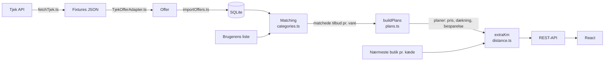

# Pipeline (skitse)

Skitse af, hvordan en indkøbsliste bliver til planer. Den færdige figur til rapportens afsnit 8 laves efter feature freeze 18. dec og tjekkes mod koden.

| Trin | Hvad sker der | Status | Afsnit |
|---|---|---|---|
| Tjek API → fixtures | Ugens tilbud fra 8 kæder hentes og gemmes som JSON | Færdig | 2.3 |
| Adapter | Tjeks format oversættes til vores `Offer` (pris i øre, ISO-datoer) | Færdig | 5, 8 |
| Import | Tilbud gemmes i SQLite; en ny import erstatter kædens gamle tilbud | Færdig | 5 |
| Matching | Tilbuddenes overskrift matches til kategorier med keywords og negative keywords | Baseline færdig, v2 i S3 | 6 |
| Filtrering | Mærkekrav og gyldighedsdato for den valgte indkøbsdag | S3 | 6, 7 |
| `buildPlans` | Kombinationer af 1–3 kæder, billigste tilbud pr. vare, sortering, reference og besparelse | Færdig | 7 |
| Nærmeste butik | Den nærmeste butik pr. kæde inden for radius | S3 | 7 |
| `extraKm` | Korteste tur-retur pr. plan minus referencens rute | Færdig | 7 |
| REST-API | `POST /plans`: liste, placering og indstillinger → planer | S3 | 8 |
| React | Listen og planerne vises; mobil og placering i S4 | S3–S4 | 8 |
